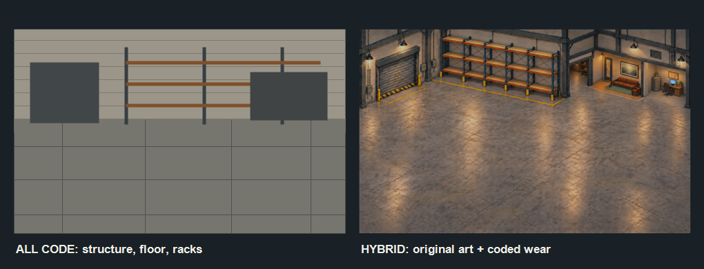

# Story opening and workshop restoration — update outline

Status: implementation underway. Warehouse condition state, five restoration stages with lights-on and lights-off plates, visible floor grime and standing water, fading footprints, local cleanup prompts, utility payments, breaker repair, manual light switch, save migration, machine power gates, host-authoritative room actions, pre-opening client/job gate, grand-opening prerequisite check and sequence, and optional restoration tutorial notices are implemented. Story starts with a skippable illustrated Millhaven departure: packing three poses, suitcase walk to the existing motorcycle, and city–bridge–farm road montage. Its captions use a transparent beveled sprite alphabet, with no dark caption panels. The montage continues into a scripted motorcycle ride along connected generated roads in the normal town renderer, a visible dismount and walk to Grandpa's porch, then his five-page conversation. The ride prioritizes route terrain and waits for visible ground on slower devices. After receiving the keys, control returns at the farm with no required destination or route. The player can travel freely; either apartment or Picture Shop entrance works without first selecting it on the GPS. The seated Grandpa, independent Sound Studio voice slot, portable utility call menu, and persistent conversation handoff are implemented. A synchronized multiplayer opening and new-shop multiplayer lobby remain pending.

## The promise

The player has returned from Millhaven City to help their grandfather, who lives on the rural farm. He owned the Picture Shop for years, but the shop has been closed for roughly ten years because he can no longer do the physical work. He is stable, present, and able to advise the player. He offers the player the shop and the chance to reopen it. The player already has an apartment in town. The story is about rebuilding a useful business with Grandpa's help, not about an impending death.

## Two starts, one continuing game

| Start | First minutes | Workshop state | Player choice |
| --- | --- | --- | --- |
| Story | Millhaven packing montage, scripted ride to farm, porch conversation | Closed, dusty, power off, neglected cutter and wrapper | After Grandpa's talk, ride to the apartment or shop in either order |
| Quick Start | Current new-shop flow and spawn | Exactly today's playable warehouse, machine placement, money, calendar and tutorial behavior by default | Existing day length, town, and tutorial setup; later add clearly priced starting cash and machine-condition presets |

The title's **New Shop** route gains a mode choice before the existing shop/town setup. Quick Start's default must reproduce the current start. Existing saves load as Quick Start without replaying any prologue. Mode selection is locked for a save slot once created; both modes use the same simulation, multiplayer session, shops, apartment, and town after the story handoff.

## Start a new shop together

The multiplayer **Host** flow offers **Host Existing Shop** and **Host New Shop**. The latter opens a clear save-slot picker showing empty, occupied and damaged slots. Selecting an empty slot reserves it for this lobby; selecting an occupied slot requires the existing overwrite confirmation before any write. Cancelling setup releases the reservation and leaves the old save untouched. The host can choose Story or Quick Start and then use the normal day-length, tutorial and town/terrain setup screens. Starting an existing shop keeps its current behavior.

The network lobby opens as soon as **Host New Shop** creates the draft session, before the host finalizes the world. Friends can join immediately using the same LAN or Direct discovery and approval rules. They see a read-only version of the setup screen with the host's selected mode, parameters, seed/preset, town-generation progress and map preview. Their own cursor and controls do not alter host choices; they can talk locally or by an external voice channel while viewing them. This is a synchronized setup view, not a video stream of the host's desktop. Send compact authoritative setup state and render the preview locally; when a generated plan is ready, verify that clients display the same plan identity/hash. Show a clear **Waiting for host to start** state and connected-player list.

The draft lobby is separate from an active shop save. Do not call the existing empty-slot default `newGame` path merely because hosting began. At **Start Together**, the host validates and commits the chosen slot, mode and frozen town plan, waits for connected clients to finish loading or times out with an actionable message, then releases a shared cinematic/gameplay start signal. Story participants see the same opening at the same time; Quick Start participants spawn into the workshop together. A guest who connects after start uses the current checkpoint and normal join flow. Host cancellation, disconnection, generation failure and occupied-slot races must return guests to a safe lobby/disconnected state without creating a partial save.

Current-code seam: `src/screens/lan_screen.lua` currently has one **HOST THIS SHOP** action and displays a selected slot; `src/runtime/lan_startup.lua` creates a default shop immediately if that slot is empty; title setup and town preview live in separate screens. The update needs a pre-game lobby/session phase and a serializable setup-preview model before the existing world snapshot protocol begins. Reuse the title setup logic rather than maintaining two different terrain generators or parameter menus.

## Story opening, beat by beat

1. **Millhaven City, packing.** The implemented, skippable illustrated montage shows the player packing, taking a suitcase to the existing motorcycle, gearing up, and departing. It uses the [packing sheet and four background plates](../../assets/source/story-intro-v1/manifest.json) with the existing motorcycle and riding gear. The [background prompts](../../assets/source/story-intro-v1/departure-background-prompts.md) are saved with the source art.
2. **Arrival road.** After the illustrated bridge and farm-road plates, the existing motorcycle and rider travel a scripted route from the Millhaven gate through the generated town road graph to the farm parking anchor. The normal outside renderer shows the ride without gameplay controls or HUD. Route tiles load ahead of the bike; movement waits if the next road section is not visible yet.
3. **Farm arrival.** The bike parks at the existing farm parking anchor. The rider dismounts, removes the riding gear, and walks through fixed farm waypoints to Grandpa's porch conversation anchor. The farm exterior is part of town generation; the story-only porch and walk anchors leave town seed layouts unchanged.
4. **Grandpa's handoff.** Dialogue establishes the ten-year closure, his limited ability to work, the apartment, and the opportunity to reopen. He gives the player the shop keys. The description of the shop's problems should be specific but encouraging: dusty floors, dead power, neglected cutter blade and wrapper, and repairs in several areas. The building itself is sound. Grandpa explains that customers must wait until the warehouse and machines are safe; after the repairs, the family can hold a grand opening. In multiplayer the player characters are siblings returning together; Grandpa acknowledges the siblings who joined the opening, then addresses the shop as a shared opportunity. Use “your sibling,” “both of you,” or “all of you” until the game has an explicit relationship/gender choice rather than guessing from a character sprite.
5. **Control handoff.** Grandpa hands over the keys and finishes speaking. The camera, HUD, and controls return with the bike at the farm. The prologue ends here. The player may leave for any destination. The map marks the apartment and shop for optional GPS guidance, but neither door requires a route selection and either visit order works. Visits persist independently of GPS guidance.

Suggested brief dialogue, subject to writing review: “I'm glad you came back. I can't run the shop the way I used to, but the building is yours if you want it. It's been shut for ten years. The power's off, the cutter needs a blade, and that wrapper needs some love. The bones are good. Take your time, put in the work, and make it your own.”

Multiplayer variant, also a draft: “You brought your sibling along! It's good to see both of you back here. I can't run the shop the way I used to, but I think the two of you can bring it back.” For three or four players, use “all of you.” Choose the variant from the connected Story participants at the start of the porch conversation, so one late join does not rewrite a line already spoken. All participating siblings receive the handoff and destination markers; the host alone advances or skips the shared scene.

Keep the sequence short enough to replay willingly, with a visible **Skip to farm handoff** action. Skipping still grants the keys, places the bike, establishes the story state, and returns free travel at the farm. Do not offer a skip that strands the player mid-route.

## Workshop restoration loop

The story workshop starts as a distinct condition preset, built on the same layout, collision mask, and machine definitions as Quick Start. Its saved condition selects an aligned warehouse background plate for worn/restored surfaces and lights on/off, plus procedural floor dirt and standing water. At first visit the player can inspect each issue. Early tasks teach existing mechanics: call the power and water utilities, repair the existing wall breaker, clear reachable floor zones, repaint worn surfaces, service the cutter blade and wrapper, run a safe test cycle, then take a first small job. Grandpa adds $420 to the usual $180 business balance. The $600 Story balance covers both utility fees and two maintenance kits purchased through the shop computer, with money left over; no kits are given away. Older Story saves receive this allowance once. Later cosmetic improvements remain optional investments.

The first visit should feel clearly different from Quick Start but stay traversable. Dust and clutter must never cover the walkmask, block exits, or hide machine controls. Power loss gates only the affected equipment and lights; the player can always inspect, leave, save, and reach the repair action. Each completed action visibly changes the room and persists across save/reload and host/guest synchronization. Client visits, job calls, written job requests, and offer creation remain blocked until the saved grand-opening flag is set. Suppliers may be held too during the closed phase, while player-initiated restoration purchases and utility calls remain available.

### Grand opening and tutorial handoff

The grand opening is a separate action after restoration. Its prerequisite check requires live power and water, repaired breaker, all three floor regions cleaned, paint restored, the installed cutter serviced with a usable blade, and the installed skid wrapper serviced. It cannot be triggered from outside the warehouse or repeated for another reward. After the host commits it, client scheduling and job channels resume, and the existing job tutorial begins from its first lesson. This avoids a client arriving during repairs or a phone call turning into an impossible job before the machines are ready.

When tutorial help is enabled, local notifications identify the next unfinished task: utilities, breaker, floor regions, paint, machine service, then the grand opening. The player may do tasks in another valid order; the guidance recomputes from saved condition instead of requiring a rigid quest flag. Grandpa's porch line establishes the goal even if tutorial help is off. The implemented 12.8-second grand-opening sequence reveals the restored warehouse, lowers a hand-drawn shop banner, flips the door sign from CLOSED to OPEN, and ends on an OPEN FOR BUSINESS card with confetti. Enter, Space, Escape, a controller confirm button, or the on-screen skip button finishes it early. The saved grand-opening flag changes at the end, so job and customer channels unlock with the final card. A synchronized multiplayer presentation and an exterior sign animation remain future work.

## Warehouse background decision

The left panel is a code-drawn structural sketch; the right retains the current authored warehouse art with code-drawn dimming and wear. The sketch is a feasibility comparison, not a final room replacement.

The current warehouse is a detailed 1536×1024 image rendered into a 960×678 scene. Its floor perspective, rack beams, doors, office, lighting and walkmask align with that art. A wholly procedural room is technically possible, but matching this detail means authoring a texture atlas, material/shader passes, perspective placement, occlusion masks and a regenerated walkmask. It would be a separate rendering project and is unlikely to be the easiest route for this update.

**Chosen hybrid:** retain the original authored plate as the restored, lights-on state and use aligned generated plates for baked lighting and structural wear. Procedural effects handle local dirt, damp patches, standing water, and small breaker sparks. Region IDs drive both overlays and cleaning tasks. Cache static overlays so mobile performance remains manageable. All plates reuse the current walkmask; art changes must not shift the dock opening, rack bays, office doorway, or floor seams.

Proof-of-concept acceptance: show clean and closed story states at 960×678 and on a phone; verify rack/pallet depth, dock aperture, office, controls, navigation, lighting transition, and frame time before committing to the renderer architecture.

### Closed-shop effect specification

The first code-drawn [comparison sketch](warehouse-restoration-preview.png) helped identify a flaw: darkening the restored sprite still showed its painted lamp glows and bright floor reflections. The first worn/off plate then looked uniformly hazy and obscured texture. The revised [five-stage plate set](restoration-stages.md) uses crisp local wear and clear light/shadow, with lights-on and lights-off artwork for every stage. The saved west, center, east cleaning states advance stages 0→1→2→3 in that order; repainting advances to stage 4. Power and the wall switch independently select each stage's lighting plate. The original authored sprite remains stage 4 with lights on.

The baked breaker box at the upper-left wall is the only breaker art. Its approach point is on the walkable floor below it; sparks appear at the box only when utility power is connected and its damaged breaker remains unrepaired. There is no extra breaker or procedural pipe. Water starts disconnected. Reconnecting water provides service; the old standing water and damp stain remain until the player cleans that floor region. There is no pipe repair task or active leak.

Floor dirt is cached procedural texture with irregular, mottled edges, using the baked dirty patch by the rear doorway as the reference. Standing water has a separate blue-gray oily texture with irregular edges, subdued highlights, and visible floor texture underneath. Each saved west/center/east cleaning state removes only its own overlay; east cleanup removes the old standing water. Preserve the floor tile perspective and leave doorways, controls, and safety lines legible. All plates keep identical navigation and collision geometry. A manual wall switch changes the lights-on bit without changing utility service or monthly billing; this supports closing the shop with lights off after restoration.

Walking through these dirty or wet areas leaves small alternating footprints along the player's actual travel direction. At most five marks per player remain visible; they fade within about 3.5 seconds. Wet prints have a blue-gray tint and dirt prints are brown. Four additional steps may carry residue beyond the patch edge. Footprints are client-side visual effects for local and remote players, never save data or collision geometry.

Generate the dirt pattern deterministically from a saved condition seed and region ID, cache it in a canvas, and redraw only when cleaning changes a region. Keep breaker sparks short and bounded. Neither grime nor standing water changes collision or the walkmask. Review all four plate swaps with stocked racks, seated customers, open loading bay, machine actors, and mobile framing; generated plates must not leave visible seams or double images when those foreground layers redraw parts of the background.

### Power and water restoration

Story mode begins with both utilities disconnected. Existing Quick Start and old saves continue with working utilities. A breaker inspection first reports **no service at the meter**. The player can use an available mobile/work phone from the farm, apartment or shop to contact the power company and water utility; this must not require the powerless shop computer. Each company quotes a one-time reconnection fee and asks the host to confirm payment from shop funds. The payment becomes a receipt. Monthly power and water billing starts only after that service is active in Story mode; Quick Start keeps its current billing schedule. The exact reconnection fees and starter funds need an economy pass before release.

After electricity is reconnected, the existing breaker box sparks until repaired. The player must inspect and repair it before workshop lights and powered machines can run. Failed attempts cannot drain funds or trap the player. The lights-off plate retains readable daylight; outdoor night can later influence natural light at the dock without resurrecting baked lamp glows. Water reconnection turns water service on; the old standing water and stain are a cleaning task with no new leak or pipe repair. Water use is gated only by the connection. Utility, breaker, cleaning, paint, and light-switch states save with the host and are visible to guests.

Utility calls, breaker repair, and visits to the apartment remain flexible. The three floor regions now clean west→center→east, followed by repainting, so each action selects the next stage plate. Restoring power and water, repairing the breaker, cleaning, and repainting are required to reach the fully restored visual state. Work actions have explicit before/after visuals and a completion checklist; no action should leave the workshop in an unwinnable state. The current room checklist is accessible at the breaker; the Story opening must also expose utility calls through the portable phone from the farm, apartment, and shop before the new mode is selectable.

### Commute day/night lighting

The commute terrain currently supplies a constant sun vector and constant ambient/sun intensities to its ground shader, so its clock does not produce a clear day/night change. Critter Party's `src/climate.lua` and `src/renderer.lua` show the reusable approach: derive solar position and daylight from calendar date and hour, then send sun, moon and ambient values to rendering shaders. The Picture Shop now has a first implementation in `src/commute/day_night.lua`: both commute cameras use calendar-driven sun direction, sky/fog colour, terrain and structure lighting, plus a light night tint. Finish this with visual captures at dawn, noon, dusk and night; check roads, buildings, foliage, player sprites, headlights and the farm approach on desktop and Android. A visible solar disc and moving shadows are optional later polish, after the lighting itself reads clearly.

## Art prepared now and remaining sprite work

New concept sources, generated with built-in ImageGen using the current player atlas as style reference:

- [Grandpa porch poses](../../assets/source/story-intro-v1/grandfather-porch-concept.png): six seated/standing key poses for idle, look, wave, speaking and greeting.
- [Player packing poses](../../assets/source/story-intro-v1/player-packing-three-poses-concept.png): packing, closing and lifting the suitcase. Only these packing actions are new; the existing motorcycle and riding gear supply the ride and mount shots.

The transparent packing poses now run as a simple three-beat animation at game scale, with the suitcase included in those poses. Grandpa has a separate seated runtime sprite, though additional idle/talk/wave cycles and refined transitions remain future art work. The existing motorcycle and riding gear are reused for the city street and road shots; no new motorcycle or gear set is needed.

## State and multiplayer contracts

- Persist `startMode`, `storyVersion`, the current prologue checkpoint, keys granted, discovered destinations, and each workshop restoration state in the host save. Older saves migrate to Quick Start with the present clean workshop.
- Keep setup-lobby state outside the saved gameplay state until **Start Together**. Replicate the host's draft mode, parameters, frozen town plan identity, preview and participant readiness to clients, but accept no guest mutations of those fields. The chosen slot remains host-owned.
- Make the host authoritative for cinematic beat changes, skip, dialogue completion, repair actions and condition state. Guests receive the same checkpoint and world state. Guests joining during the prologue spawn at the farm or current cinematic rendezvous and cannot independently advance the shared story.
- Save at stable beat boundaries and after the handoff, not every animation frame. On restart, resume at the last safe beat; after handoff, resume normal play and never replay the intro automatically.
- Keep solo and LAN starts on the same path. A host skip should transition everyone together. Personal camera/HUD visibility stays local even though the timeline is shared.

## Implementation order and review gates

1. Add the mode choice and save migration; prove existing saves and the default Quick Start remain unchanged.
2. Add **Host Existing/New Shop**, explicit slot selection and a pre-game lobby protocol. Sync read-only setup and town previews; test guest join, cancellation, occupied slots and the shared start barrier.
3. ~~Build the farm porch anchors and a data-driven route from Millhaven bridge to the farm; test several generated towns and camera framing on mobile.~~ Implemented with focused desktop/mobile Story smokes and generated-route checks across several seeds. Continue visual tuning as the prologue grows.
4. Integrate cleaned sprite frames and the host-driven cinematic/checkpoint sequence, sibling-aware dialogue, skip and control handoff.
5. Finish the story workshop condition preset, four aligned background plates, procedural floor dirt/standing water, disconnected utilities, baked-breaker interaction, restoration tasks, machine power gates, portable-phone utility calls, and safe first-job economy. Verify one-time fees and monthly billing transitions.
6. Finish and review commute day/night lighting across seasons, views and devices; check that the closed shop's natural and powered lighting match the outdoor time of day.
7. Play through solo, host plus guest, skip, late join, reconnect, save/reload at each beat, and both apartment-first and shop-first travel without a required choice. Compare warehouse performance and visibility with Quick Start before release.

Open tuning choices for later review: Grandpa's name, exact calendar year of closure, dialogue voice, how long the montage should run, and which cosmetic repairs remain optional. None blocks the architecture above.
