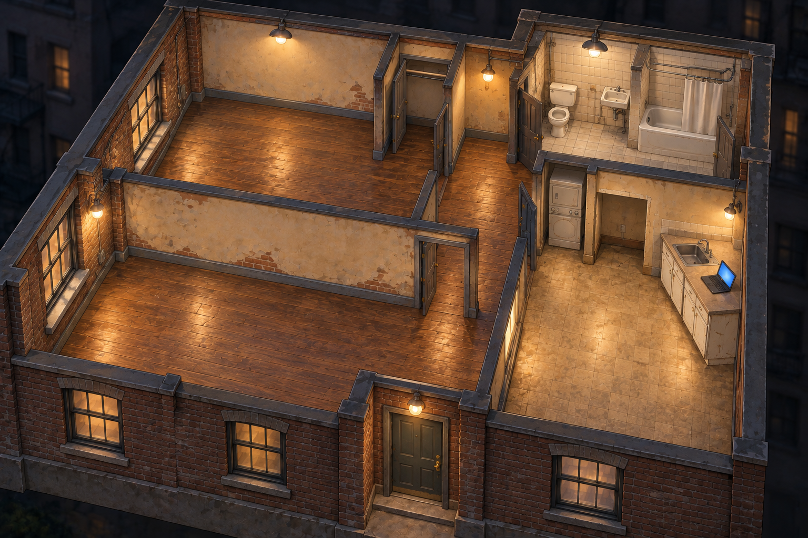
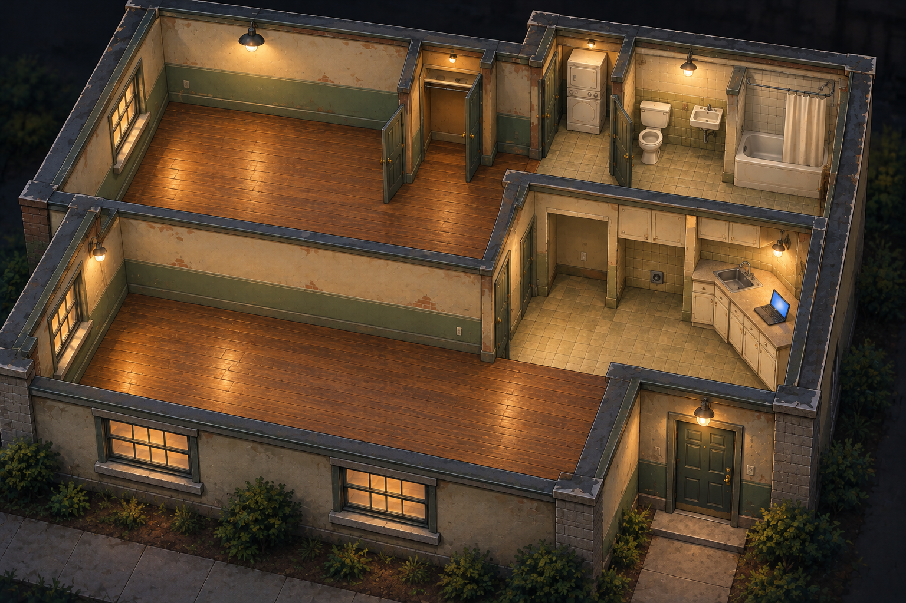
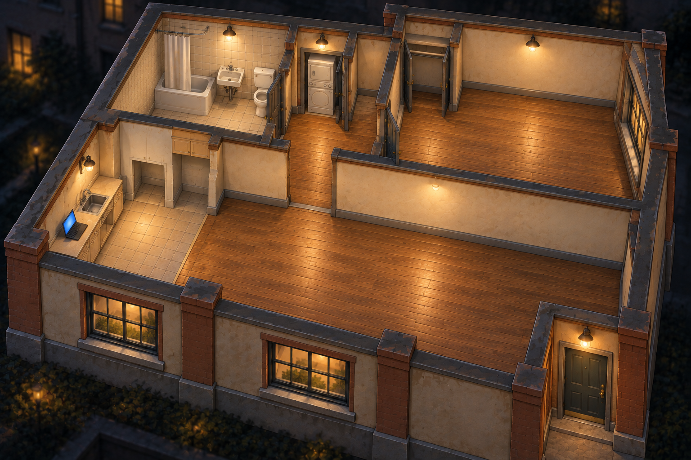
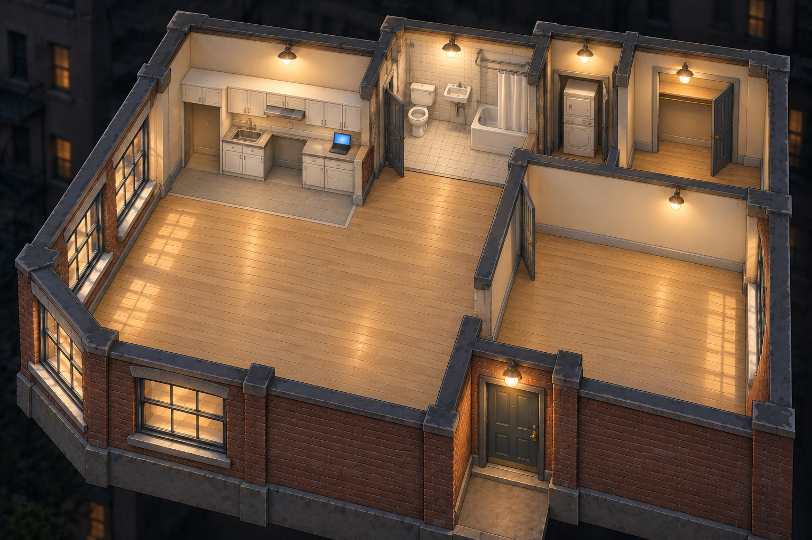
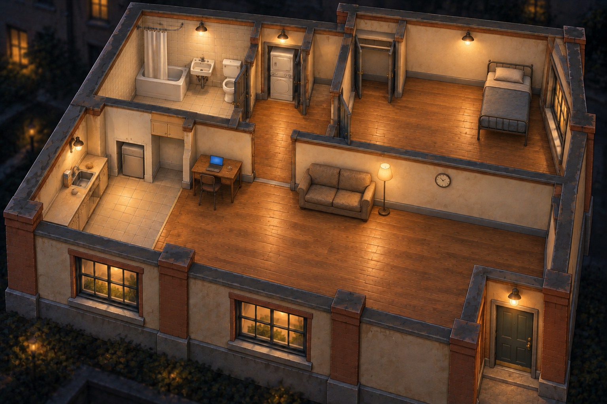

**Apartment concepts — first visual review, November 1, 2026**

Generated with the built-in ImageGen tool using the approved warehouse art as the style reference. Full prompts and source paths are recorded in [prompt-set.json](prompt-set.json). These are visual concepts, not integrated or collision-validated game assets.

The default start is empty apart from fixed plumbing/laundry, the short built-in sink counter, and one laptop on its dry end. The laptop will be a separate movable sprite in production. A modest furnished preset is optional and independent of apartment selection. Random chooses an apartment together with its listed rent and condition.

| Concept | Condition | Provisional monthly game rent |
| --- | --- | --- |
| [Brick walk-up](brick-walkup-empty.png) | Shabby | $450 |
| [Garden](garden-empty.png) | Worn but serviceable | $600 |
| [Courtyard](courtyard-empty.png) | Fair and cared for | $800 |
| [Corner](corner-empty.png) | Good | $1,000 |

[Courtyard with the optional modest furniture package](courtyard-modestly-furnished.png) keeps the same architecture and adds a cheap single bed, worn couch, mini fridge, small desk/chair/laptop, lamp, clock, cup, and basic groceries.

All five images were visually inspected. The condition progression, bare living/bedroom spaces, fixed fixtures, laptop access, and restrained furnished option are visible. Precise doorway clearance, fixture scale, foreground-wall cutaways, walkmasks, depth sorting, and eight-direction furniture sprites still need production work. Some generated kitchen cabinetry extends beyond the minimal counter specification; decide its final fixed-versus-purchasable boundary before extracting production art.

Review primarily the illustration style, condition/rent range, apartment character, and furnished-versus-empty distinction. Production should use a measured layout rather than assuming every generated doorway is already navigable.

